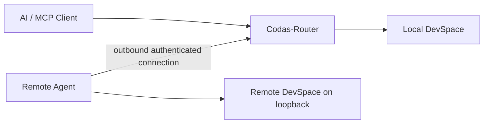

<div align="center">

# Codas-Router

### **Route the Project, Not Devices.**

**Give the order anywhere. Codas finds the machine that owns the workspace.**

[](https://github.com/SeanWu089/Codas-Router/releases/latest)
[](https://nodejs.org/)
[](LICENSE)
[](https://modelcontextprotocol.io/)

**A thin, self-hosted routing layer that lets AI agents work across your computers without making you choose the machine every time.**

</div>

> **Current codebase (2026-11-23):** The default branch includes the tested
> **Device Registry v1**, **Codas-mac v0.3.12** menu-bar app, and Mac-side
> workspace routing / wrong-device protections. The Mac component now includes
> matching device-dot ordering, fixed panel geometry and a verified exact-path
> login installer. These components were
> verified on macOS. The cross-network, **Mac-offline Windows v0.2** goal is
> **still under development**: Windows can report an Agent heartbeat even
> when its DevSpace cannot execute commands. Do not interpret a registered
> device as execution-ready. See [distributed routing](docs/distributed-routing.md).

---

## What is Codas-Router?

Your files do not live on one computer.

Your projects might be on a MacBook, a Windows desktop, a home server, a GPU box, or a machine you left at the office. Traditional remote access lets you *reach* those machines — but you still have to remember where the work lives, connect to the right host, and switch context yourself.

Codas-Router makes the **physical machine a routing detail**.

It sits in front of [DevSpace](https://www.npmjs.com/package/@waishnav/devspace) and exposes one MCP-facing entry point:

```text
You / AI client
      |
      | one MCP endpoint
      v
Codas-Router
      |
      | "Where does this workspace live?"
      |
      +----> Mac DevSpace ------> /Users/.../project
      |
      +----> Windows Agent -----> DevSpace -----> C:\Users\...\project
```

Open a Windows workspace from a conversation currently executing through a Mac Router, and Codas routes the call to Windows. After the workspace is opened, its `workspace_id` stays bound to that device, so later reads, edits, shell commands, and Git operations keep going back to the same machine automatically.

> **The AI should care about the workspace — not which box happens to hold it.**

---

## The fun version

Instead of:

```text
"Which computer has that file?"
-> remote desktop
-> switch machine
-> find project
-> reconnect tools
-> do the thing
```

you can aim for:

```text
"Move a shortcut on my Windows desktop to the Recycle Bin."
```

and the path becomes:

```text
AI client
   -> Codas-Router on Mac
      -> C:\Users\...\Desktop resolves to Windows
         -> Windows Agent
            -> local DevSpace
               -> action happens on Windows
```

No separate Windows MCP endpoint needs to be exposed to the client, and the remote machine does not need an inbound public port.

---

## Why build this on DevSpace?

Codas does **not** try to replace DevSpace.

DevSpace is the execution backend: it owns local workspaces, filesystem operations, shell execution, coding-agent integrations, and local permission boundaries. Codas adds the missing **multi-device control plane** in front of it.

| Capability | DevSpace | Codas-Router + DevSpace |
| --- | :---: | :---: |
| Local workspace / file / shell tools | ✅ | ✅ |
| Local allowed-root boundary | ✅ | ✅ |
| One MCP entry point | ✅ | ✅ |
| Multiple physical computers behind that entry point | — | **✅** |
| Device registry + online presence | — | **✅** |
| Windows/macOS-aware path routing | — | **✅** |
| `path -> device` selection | — | **✅** |
| Sticky `workspace_id -> device` binding | — | **✅** |
| Outbound-only remote Agent transport | — | **✅** |
| Fail closed on ambiguous/offline routes | — | **✅** |
| Per-device enrollment credentials | — | **✅** |
| Self-contained Windows Agent installer | — | **✅** |

> **DevSpace decides how work happens on a machine. Codas decides which machine should receive the work.**

---

## Routing model

Codas V1 uses a small set of deterministic rules.

### 1. Path chooses the device

Each device advertises explicit workspace roots.

```text
Mac
  /Users/you/...

Windows
  C:\Users\you
  D:\
```

An `open_workspace` call is matched with platform-aware path semantics. The most specific matching online device wins.

### 2. Workspace identity becomes device affinity

When DevSpace returns `workspace_id = ws_xxx`, Codas persists:

```text
ws_xxx -> device_id
```

Every later MCP call carrying that `workspace_id` returns to the same device.

### 3. Ambiguity fails closed

Codas does not silently guess when:

- multiple devices are equally valid;
- a bound device is offline;
- one MCP batch tries to cross devices;
- a workspace has no valid binding.

Wrong-machine execution is worse than an explicit routing error.

---

## Network model

> **v0.2 development:** the original Mac-hosted Router remains supported, but
> independent Router nodes and authenticated peer routing are now under
> development. See [Distributed routing v0.2](docs/distributed-routing.md)
> for the explicit Mac-offline behavior and setup boundaries. Do not mistake
> independent Router nodes for automatic failover of a client URL.

Remote Agents connect **outbound** to the Router.



The remote computer does **not** need a public IP, inbound firewall rule, its own public MCP URL, or a second public tunnel just for Codas.

The Router creates a one-time enrollment boundary, then issues a separate long-lived token for that device. DevSpace OAuth stays local to each computer.

---

## Project naming

The repository and Node package are **Codas-Router** and `codas-router`.
The product is **Codas** and the macOS menu application is **Codas-mac**.
New source checkouts and release artifacts use these names.

Existing installations keep their protocol and identity compatibility:
`/_codassol/*`, `codassol_list_devices`, `CODASSOL_*`, `.codassol`,
`com.codassol.*`, and existing Windows task/runtime names remain valid.
These identifiers refer to saved credentials, running services and installed
clients; renaming the project does not reset pairing or create duplicate jobs.
Historical tags and dated deployment paths retain their original spelling.

## Quick start

### Router machine

Requirements: Node.js 22+ and an initialized local DevSpace.

```bash
git clone https://github.com/SeanWu089/Codas-Router.git
cd Codas-Router

npm test
./scripts/mac/install-autostart.sh
```

Check the Router and get the pairing token:

```bash
curl http://127.0.0.1:17676/_codassol/health
npm run router:lan
npm run router:pairing-token --silent
```

### Windows Agent

Choose a release explicitly labeled **Windows** from **[GitHub Releases →](https://github.com/SeanWu089/Codas-Router/releases)** and use its listed asset. New source builds use `Codas-Windows-*` names; historical release assets retain their original names. The repository-wide latest release can belong to a different component.

Then:

1. Extract the ZIP.
2. Double-click `INSTALL.cmd`.
3. Choose the workspace-access policy.
4. Enter the Router URL.
5. Paste the one-time pairing token.

The installer carries its own Node.js 22 x64 runtime, installs DevSpace privately under `%LOCALAPPDATA%\CodasSol\Agent`, and creates current-user autostart tasks.

Recommended Windows access policy:

```text
C:\Users\<you>
+ all fixed non-system drives
```

It intentionally does **not** expose the whole `C:\` system drive by default.

Verify from the Router:

```bash
npm run router:agents --silent
```

Full Windows details: [`docs/windows-setup.md`](docs/windows-setup.md)

---

## Security by default

- **Loopback-first Router** — default listener is `127.0.0.1`.
- **Outbound remote Agents** — remote machines initiate the connection.
- **One-time pairing token** — used only to enroll a device.
- **Different per-device token** — enrollment credentials are not reused as runtime credentials.
- **Local DevSpace OAuth** — DevSpace owner/access/refresh tokens stay on their own machine.
- **Explicit allowed roots** — Windows DevSpace roots and advertised Router roots are synchronized.
- **No whole-system-drive default** — the recommended Windows policy avoids exposing `C:\`.
- **Fail-closed routing** — ambiguity or offline state produces an error instead of a guess.
- **Private state stays outside Git** — tokens, device records, bindings, and local paths remain private.
- **Public release bundles contain no build-machine LAN address by default** as of `v0.1.2`.
- **Public installer examples use neutral placeholders** as of `v0.1.3`.

Read [`SECURITY.md`](SECURITY.md) before exposing a Router beyond a trusted network.

---

## What Codas is — and is not

**Not another remote desktop.** Remote desktop streams a screen and input. Codas routes structured agent/tool operations to the correct execution environment.

**Not a VPN replacement.** VPNs solve private network reachability. Codas solves agent action routing and workspace affinity. They can complement each other.

**Not an AI model.** Codas does no inference. Bring the AI client/model you want; DevSpace remains the execution layer.

**Not a hosted service.** The public repository is the framework. Device identities, credentials, paths, and bindings belong to your private deployment.

---

## Why the routing abstraction matters

There are already strong projects for multi-device agent execution, remote desktops, gateways, and self-hosted workers.

Codas deliberately explores a smaller abstraction:

```text
workspace identity
       |
       v
physical-machine affinity
```

The user or model should not need to call `remote_exec(agent_id="windows-pc", ...)` for every operation. Once a workspace is resolved, normal DevSpace tools keep their normal shape. The Router carries the machine affinity.

That makes Codas closer to a **transparent workspace router** than a remote-control dashboard.

---

## Releases

### `v0.1.3` — historical Windows Agent

Public artifact hygiene. Installer examples use neutral placeholders rather
than test-machine-looking usernames or addresses.

### `v0.1.2`

Public bundle privacy hotfix. Public Windows artifacts no longer embed the build machine's LAN Router address.

### `v0.1.1`

Fixed the first real multi-device integration issue: DevSpace `allowedRoots` and Agent-advertised roots could disagree on an existing Windows installation. The installer now synchronizes both and offers an explicit access policy.

### `v0.1.0` — historical / superseded

First self-contained Windows Agent bundle. Kept as a prerelease so the development history remains inspectable.

See **[all Releases](https://github.com/SeanWu089/Codas-Router/releases)**.

---

## Where this can go

The next useful layers are not “more AI.” They are **better control over a personal compute fabric**:

- per-action approvals and capability policies;
- audit logs and device activity history;
- device aliases, tags, groups, and capability-aware routing;
- signed Agent updates and protocol compatibility checks;
- Linux packaging and service installers;
- GUI/browser/computer-use capabilities behind explicit permissions;
- mobile-first command and approval surfaces;
- secure Internet reachability without directly exposing the Router;
- task hand-off between machines;
- wake/sleep awareness and Wake-on-LAN;
- separate device presence from execution-backend health, with automatic DevSpace recovery;
- routing by hardware capability (`gpu`, `cuda`, `macos`, `office-pc`) in addition to path;
- consumer workflows such as “send me that file,” “start this download,” or “run this task at home.”

> **What if all of your computers behaved like one addressable pool of capabilities?**

---

## Development

```bash
npm test
```

See [Git branches, worktrees, and release workflow](docs/git-workflow.md)
for the current `main`/`develop` policy, protected in-progress worktrees,
and a clean history view that excludes internal DevSpace review snapshots.

Current V1 tests cover Agent enrollment/heartbeat/job transport, local DevSpace OAuth, Windows path semantics, most-specific-root selection, ambiguity/offline fail-closed behavior, sticky workspace bindings, cross-device batch rejection, Router proxying, and health checks.

---

## Public framework vs. private deployment

Never commit or publish real device credentials, pairing secrets, local path inventories, workspace bindings, tunnel credentials, API keys, or certificates/private keys.

Local Router state belongs under `~/.codassol/`. Windows Agent state belongs under `%USERPROFILE%\.codassol\`.

---

**Experimental Device Registry v1:** See [the device directory and authenticated rename API](docs/distributed-routing.md#device-registry-v1-experimental-api) for cross-node discovery, stable installation identity, peer metadata synchronization and offline display semantics.

## License

MIT.

<div align="center">

### **Route the Project, Not Devices.**

</div>

## Codas-mac menu bar controller (v0.3.12)

**Codas-mac** is the native Swift/AppKit menu component, installed at
`~/Applications/Codas-mac.app`. It keeps the existing blue Finder icon and the
monochrome menu icon. The app and Router have independent version numbers and
release cycles.

### Changes in this version

- Remote-device dots and tooltip numbers follow the **Other Devices** row
  order. Connected devices are green; offline, unknown and stale states are
  grey. The local Mac is not counted as another remote dot.
- The panel uses a stable 350 × 540 point layout, reduced when needed to fit
  the active screen. Headers, Back and the footer stay outside scrolling
  content, and navigation resets the content scroll position.
- The menu closes on outside clicks or app deactivation while preserving
  clicks inside the panel and attached confirmation windows.
- Builds create a signed ZIP outside iCloud. No loose build application is
  left for Spotlight to choose instead of the installed application.
- Installer revision 2 verifies the canonical application and one exact-path
  login launcher before optional legacy cleanup. Protected old copies are
  reported separately and do not undo a working installation. Rollback
  preserves whole directories instead of deleting and extracting over them.

The user accepted the installed 0.3.12 interface. Automated checks cover
ordering, freshness, scrolling, layout and installer failure recovery.
Physical reboot acceptance remains a separate check; a successful source
build alone does not establish that result.

### Build, package and install

Use macOS with Apple command line tools (`swiftc`), Python 3 and Node.js 22+.
Run the regression checks and build from this repository:

```sh
npm test
npm run test:mac
zsh scripts/mac/menu-app/build.sh
```

The build produces `dist/Codas-mac-0.3.12.zip`. It stages the app without
installing it. Inspect a candidate-only installation plan with:

```sh
python3 scripts/mac/menu-app/install-menu.py --source dist/Codas-mac-0.3.12.zip --plan
```

To install from a locally authorized terminal, replace `--plan` with `--apply`.
The installer writes `~/Library/LaunchAgents/com.codas.mac.menu.plist`, which
launches `~/Applications/Codas-mac.app` through the bundled native helper.
It verifies the actual running path, one application instance and same-PID
reuse. Installing the menu component does not restart Router or DevSpace.

For a transferable installer folder:

```sh
python3 scripts/mac/menu-app/package-release.py --source dist/Codas-mac-0.3.12.zip --output dist/Codas-mac-0.3.12-installer
```

The folder contains the signed app ZIP, the installer, its double-clickable
`Install-Codas-mac.command` and generic checksum/settings files. It contains
no developer-machine paths, installation logs, credentials or device records.
The app is ad-hoc signed for integrity checking; it is not Developer ID signed
or notarized. macOS security prompts for a downloaded build remain applicable.

### Connection and usage display

The local row reflects independent loopback Router/DevSpace health. Remote
connection state and actual command execution verification remain distinct.
Device state expires after 20 seconds; registered devices stay listed when
refresh fails. Outbound probes appear in Connection details and do not dim
an otherwise usable menu icon.

The usage summary refreshes every two seconds. Its authenticated loopback API
provides HTTPS request counts, payload bytes, transfer rates, category totals
and the last 100 sanitized request records. No raw URLs, query strings,
request/response bodies or credentials are retained. Counts include health
and protocol traffic, exclude HTTP headers/TLS overhead and edge-rejected
requests, and are not provider billing totals. Up to five seconds of recent
counts can be lost after an abrupt Router exit. Older Routers without this
API show “Usage unavailable”; updating that backend is a separate deployment.

The device client reads the local admin state from `~/.codassol/router.json`
and uses `/_codassol/devices` on loopback only. Older Router installations
have a metadata-only fallback that does not invent online states or offer
unsupported renames. A healthy peer heartbeat does not prove remote command
execution.

### Existing DevSpace installations

The separate managed DevSpace service keeps its existing identity
`com.codassol.devspace.mac` and compatibility support directory
`~/Library/Application Support/CodasSol-mac`. The menu validates that the
managed PID owns the listener before offering Stop; it does not terminate
an unrelated externally started DevSpace process.

`scripts/mac/menu-app/migrate-devspace.py` is the existing explicit DevSpace
migration worker. It validates the runtime and listener, stages an inactive
rescue job and independent watchdog, and verifies both health endpoints after
a controlled switch. That operation can interrupt the connection and is not
part of a normal menu update. Full physical login/reboot and real service
Stop/Start acceptance remain separate from isolated regression tests.
